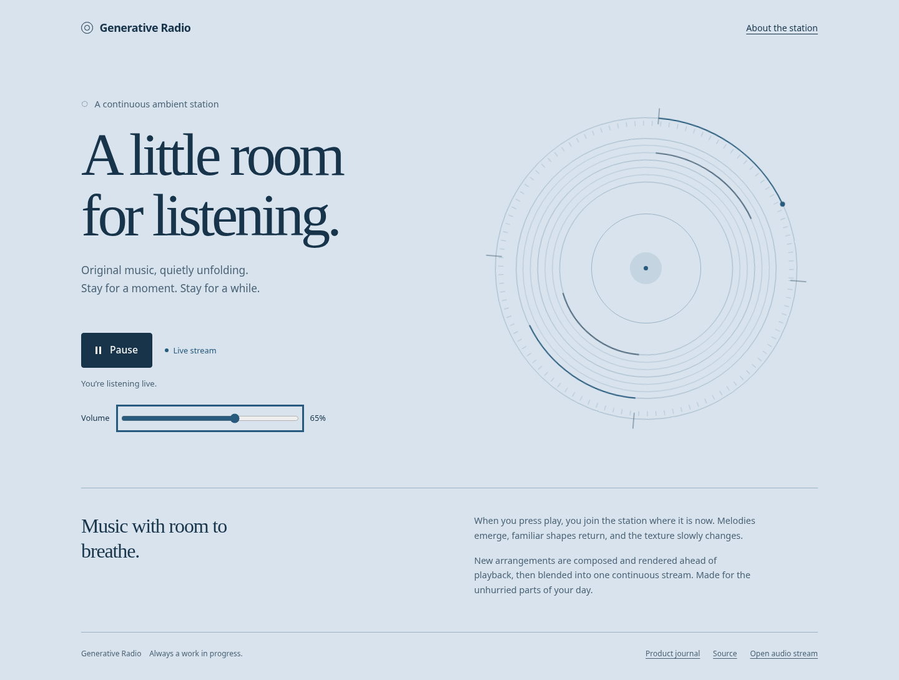

# Generative Radio — product journal

A living record of what we are building, what we have learned, and what we may try next. Updated 15 November 2026, Asia/Kolkata.

## The starting idea

An always-on station that composes its own ambient music. Press play and enter a continuous musical space: calm enough to work, read, rest or sleep with, but alive enough that an attentive listener hears development. The station should feel like a place worth returning to.

The first implementation uses musical rules and seeded probability to write original arrangements, FluidSynth to play them, and Liquidsoap/Icecast to broadcast them. It renders ahead into a buffer, so listening does not depend on every note being generated at playback speed. The core runs on a CPU without an external generation API. Available GPU compute is an opportunity for experiments, not a requirement for listening.

This journal is a working direction, not a definition of perfection or a promise that every proposed feature will ship. We will keep iterating based on listening, measured behavior and the ideas that prove worthwhile. Release checklists describe evidence for a release; they do not exhaust the product's ambition.

## What the listener has told us

The first melody was pleasant and listenable. After longer listening it became **too repetitive**. That is the most consequential product feedback so far: a station must sustain interest over hours, not merely produce one attractive short clip.

The listener also asked whether the music is generated live, wanted memory/system monitoring and recovery drills, and asked for continued implementation, PRs and CI-cleared merges. Reliability and musical development both belong in the product.

## What works today

- A local continuous MP3 station at `http://localhost:8000/radio.mp3`.
- Original seeded arrangements with several harmonic paths, variable chord holds, developed melodic phrases, changing texture and quieter openings/releases.
- A render-ahead queue, independent fallback music, crossfades, retries, cleanup and bounded retained audio.
- Decoded-audio supervision: it can detect persistent silent, missing or hung output and restart its owned Liquidsoap process within a rolling restart budget. Icecast outages allow native reconnection.
- Actual failure drills, a completed 30-minute test and a separate one-hour variety baseline. The hour contained 3,600 seconds of audio with no detected silence at −50 dB lasting at least two seconds; all 64 monitoring samples were healthy.
- Automated Python 3.11/3.14 checks plus real rendering and four-service streaming CI. PRs #1–#6 have merged after passing CI; the watchdog is deployed locally.
- A public repository under the MIT software license. Bundled/installed third-party tools and the SoundFont retain their own licenses; attribution is in the README.

The stream is locally accessible, not a deployed public service. Objective audio analysis does not establish that the music is emotionally satisfying. Listening acceptance of the variety update is still open.

## Tonight's work — 15 November

### Recovery that an operator can repeat

The one-off backup/restore experiment worked. The new implementation provides `create`, `verify` and `restore` commands, with a consistent SQLite snapshot, completed audio, checksums and refusal to overwrite existing station data. A restore should carry the station to another machine, preserve its musical seed sequence, recover interrupted render jobs and replenish the queue.

The backup feature now has 16 tests; the full 58-test local suite passes. An actual read-only live-volume backup captured 43 jobs and 89 files (about 921 MB). An isolated restore dispatched valid two-minute audio and rendered a new 20-second segment in about 0.9 seconds while preserving job/seed continuity. Review also exposed a concurrent-restore race; an exclusive reservation and a failing-then-passing regression now protect the empty destination. Operator commands and off-host/fresh-volume instructions are included. Actual off-host storage and a recovery drill on the target VPS remain open.

### In progress: longer listening with the watchdog deployed

A fresh one-hour decoded recording and resource/queue/health monitor are running against the deployed watchdog configuration. This is separate from the completed pre-watchdog baseline. The result is pending; I will record duration, silence, restarts, queue errors and memory when the processes actually finish.

### Built locally: an approachable listening experience

The first listener page now runs at `http://localhost:8080`: a quiet blue radio dial, an obvious play/pause control, volume and honest connection state. It opens no audio connection until you ask. Pause releases the stream; resume joins where the station is now. Network failures get three automatic reconnect attempts, then an explicit retry button. The page explains that new music is composed ahead of playback.

The page is static HTML/CSS/JavaScript with an optional non-root, read-only Caddy service. The proxy exposes the audio mount and page, with administration/status/data paths returning 404. It adds no account, external assets, analytics or Node server. JavaScript-disabled browsers get native audio controls.

Actual isolated Chrome tests have played and resumed the stream, adjusted volume by keyboard, recovered after a real failed media request, checked 390px/320px layouts and reduced motion, and verified the native fallback. Fifteen deterministic tests cover controller races, cancellation, bounded recovery and text contrast. Visual review led to darker secondary text to meet 4.5:1 contrast. Real mobile devices and public HTTPS still need validation. This local iteration is under PR/CI delivery; it is not a public listening URL yet.

The product is now becoming a place to listen, rather than a stream address to copy. Next, the musical-memory and longer-arc experiments below should improve what it feels like to stay there.

### Next: an operable public station

Prepare HTTPS and a deployment/runbook with secure generated credentials, restricted administration, startup/reboot checks, monitoring, upgrades, backup and rollback. The actual VPS and hostname are still unspecified. I will prepare what can be tested locally without inventing a deployment target or silently purchasing infrastructure.

## Musical ideas worth developing

These are candidate experiments, in priority order. Their order may change when listening reveals something better.

### 1. Musical memory across segments

Today each segment has variation, but the station has little awareness of what it recently played. Track recent harmonic paths, phrase shapes, density and instrument combinations; discourage immediate repetition and schedule a change after an extended stable passage. The listener should hear continuity with occasional meaningful turns.

Test by rendering the same long session before and after, measuring repeated sequences and listening at transitions. Avoid turning anti-repetition into arbitrary novelty: repeated motifs can be comforting, and the point is development.

### 2. Longer musical arcs

Give the station a sense of chapters: an introduction, emergence of a motif, a more active middle, a retreat and a transition. Reuse a phrase in altered rhythm/register rather than constantly drawing unrelated notes. Let sections breathe; density and silence between notes are composition tools.

Keep a coherent tonal palette within an arc. Explore related modes or keys only when transitions are explicitly composed and listening supports them. A random key switch is not progress.

### 3. A more distinctive sound

Explore a few carefully chosen instrument combinations, register spacing, restrained ambience and evolving pad/bass balance. The current small General MIDI SoundFont is practical but places a ceiling on character. Compare legal, redistributable timbres or simple synthesis, measure CPU/render cost and check provenance before adopting assets.

Do not mistake more effects, more instruments or higher volume for richer music. Keep headroom and make every layer earn its place.

### 4. A station that can fit the moment

After the core music is convincing, try a small number of intentional energy profiles, such as focused and resting. Profiles would change density, pulse, brightness and development speed together. A gradual time-of-day arc could be useful, but should be optional and use a clearly chosen timezone.

Start with one coherent station before multiplying channels. Avoid genre labels that the output does not actually deliver.

### 5. Use the GPU where it earns its cost

Consider offline experiments in timbre or phrase generation, or musical similarity analysis to spot repetition. Compare results with the deterministic baseline on listening quality, latency, memory, licensing and reproducibility. Keep any model off the critical playback path until it proves useful and can fail without stopping the station.

The station does not need an AI badge. If rule-based composition sounds better for this purpose, keep it.

## How an iteration earns a place

For an audible change, retain reproducible seeds and make before/after renders long enough to expose repetition. Check duration, peaks, loudness, gaps and transition behavior, then listen. Explain what improved and what tradeoff appeared. Passing audio metrics is necessary evidence, not a substitute for taste.

For an operational change, reproduce the failure, verify recovery and preserve existing music/data. Ship cohesive PRs with concrete validation; merge only after current-head CI passes. Keep unfinished work in draft. Record real results here rather than rewriting proposals as accomplishments.

Useful listening questions: After twenty minutes, does the station still feel alive? Are changes welcome or distracting? Does a motif return with purpose? Would someone leave it on, and come back tomorrow?

## Open questions for future listening

- Does the current variety update solve enough of the repetition problem, or does the sound palette itself tire the ear?
- Is the station most compelling for focus, rest, active listening, or a deliberate combination?
- What should be recognizable about this station after hearing only thirty seconds?
- Which changes improve an hour of listening rather than a screenshot or a demo?

These are prompts for observation, not blockers to the work already underway.

## Evidence and continuation

Operational details and measured acceptance results live in [product-readiness.md](product-readiness.md), with implementation context in [HANDOFF.md](../HANDOFF.md). Local recordings, runtime logs and backup fixtures remain Git-ignored. This journal will gain dated entries as ideas are tested, shipped, revised or dropped.

## Iteration log

### 15 November: recovery tools landed; listening gets a front door

PR #8 merged verified backup/restore commands and the operator runbook after all current-head CI checks passed. An actual isolated recovery preserved 43 jobs/89 files, dispatched valid two-minute music and rendered the next segment in under a second. Off-host and target-VPS recovery still need real destinations.

The listener page is being delivered next, including controller tests, browser checks and proxied-audio CI. The deployed watchdog's one-hour soak continues; no final result is claimed until recording and monitoring finish. No core service was recreated to add the page.
