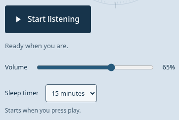

# Generative Radio — product journal

A living record of what we are building, what we have learned, and what we may try next. Updated 15 November 2026, Asia/Kolkata.

## The starting idea

An always-on station that composes its own ambient music. Press play and enter a continuous musical space: calm enough to work, read, rest or sleep with, but alive enough that an attentive listener hears development. The station should feel like a place worth returning to.

The first implementation uses musical rules and seeded probability to write original arrangements, FluidSynth to play them, and Liquidsoap/Icecast to broadcast them. It renders ahead into a buffer, so listening does not depend on every note being generated at playback speed. The core runs on a CPU without an external generation API. Available GPU compute is an opportunity for experiments, not a requirement for listening.

This journal is a working direction, not a definition of perfection or a promise that every proposed feature will ship. We will keep iterating based on listening, measured behavior and the ideas that prove worthwhile. Release checklists describe evidence for a release; they do not exhaust the product's ambition.

## What the listener has told us

The first melody was pleasant and listenable. After longer listening it became **too repetitive**. That is the most consequential product feedback so far: a station must sustain interest over hours, not merely produce one attractive short clip.

The listener also asked whether the music is generated live, wanted memory/system monitoring and recovery drills, and asked for continued implementation, PRs and CI-cleared merges. Reliability and musical development both belong in the product.

## What works today

- A local continuous MP3 station at `http://localhost:8000/radio.mp3`.
- Original seeded arrangements with several harmonic paths, variable chord holds, developed melodic phrases, changing texture and quieter openings/releases.
- A render-ahead queue, independent fallback music, crossfades, retries, cleanup and bounded retained audio.
- Decoded-audio supervision: it can detect persistent silent, missing or hung output and restart its owned Liquidsoap process within a rolling restart budget. Icecast outages allow native reconnection.
- Actual failure drills, 30-minute and one-hour baselines, and a completed two-hour musical-memory recording. The latest run contains exactly 7,200 seconds with no detected silence at −50 dB lasting two seconds; all 226 watchdog observations were healthy.
- Automated Python 3.11/3.14, rendering/streaming, browser and hardened HTTPS checks. PRs #1–#15 have merged after passing current-head CI.
- A local listening page with bounded reconnection, native fallback and an optional personal sleep timer.
- Recoverable musical chapters, verified backup/restore commands and an opt-in production deployment package.
- An offline, matched-score SoundFont comparison bench and a read-only HTTPS monitor that decodes actual audio. The current TimGM sound stays on air.
- A public repository under the MIT software license. Bundled/installed third-party tools and the SoundFont retain their own licenses; attribution is in the README.

The stream is locally accessible, not a deployed public service. Objective audio analysis does not establish that the music is emotionally satisfying. Listening acceptance of the variety update is still open.

## Tonight's work — 15 November

### Recovery that an operator can repeat

The one-off backup/restore experiment worked. The new implementation provides `create`, `verify` and `restore` commands, with a consistent SQLite snapshot, completed audio, checksums and refusal to overwrite existing station data. A restore should carry the station to another machine, preserve its musical seed sequence, recover interrupted render jobs and replenish the queue.

The backup feature now has 16 tests; the full 58-test local suite passes. An actual read-only live-volume backup captured 43 jobs and 89 files (about 921 MB). An isolated restore dispatched valid two-minute audio and rendered a new 20-second segment in about 0.9 seconds while preserving job/seed continuity. Review also exposed a concurrent-restore race; an exclusive reservation and a failing-then-passing regression now protect the empty destination. Operator commands and off-host/fresh-volume instructions are included. Actual off-host storage and a recovery drill on the target VPS remain open.

### Completed: one hour with the watchdog deployed

The deployed watchdog configuration completed a fresh one-hour recording: exactly 3,600 seconds, no silence at −50 dB lasting at least two seconds, peak −7.99 dBFS and RMS −24.52 dBFS. All 114 samples were healthy. There were no container/recovery restarts, OOM kills or queue errors, and core container identities stayed unchanged.

Broadcaster memory ranged from 240.3–263.4 MiB; quarter-hour averages stayed near 243–245 MiB. After the run, SQLite integrity passed, 11 tracks were ready, temporary work was empty and the data volume used about 907 MB. The optional listener page was added and browser-tested during the run without recreating core services. Public-target soak and listening acceptance remain open.

### Built locally: an approachable listening experience

The first listener page now runs at `http://localhost:8080`: a quiet blue radio dial, an obvious play/pause control, volume and honest connection state. It opens no audio connection until you ask. Pause releases the stream; resume joins where the station is now. Network failures get three automatic reconnect attempts, then an explicit retry button. The page explains that new music is composed ahead of playback.

The page is static HTML/CSS/JavaScript with an optional non-root, read-only Caddy service. The proxy exposes the audio mount and page, with administration/status/data paths returning 404. It adds no account, external assets, analytics or Node server. JavaScript-disabled browsers get native audio controls.

Actual isolated Chrome tests have played and resumed the stream, adjusted volume by keyboard, recovered after a real failed media request, checked 390px/320px layouts and reduced motion, and verified the native fallback. Nineteen deterministic tests cover controller races, cancellation, bounded recovery and text contrast. Visual review led to darker secondary text to meet 4.5:1 contrast. Review found and fixed a native-pause-during-connection race; a real delayed-request browser test now proves it cancels automatic retries. Real mobile devices and public HTTPS still need validation. PR #9 merged after all four current-head checks passed, including real browser playback/recovery. It remains a local listening URL; public HTTPS still needs a target hostname.

The product is now becoming a place to listen, rather than a stream address to copy. Next, the musical-memory and longer-arc experiments below should improve what it feels like to stay there.

### Next: an operable public station

Prepare HTTPS and a deployment/runbook with secure generated credentials, restricted administration, startup/reboot checks, monitoring, upgrades, backup and rollback. The actual VPS and hostname are still unspecified. I will prepare what can be tested locally without inventing a deployment target or silently purchasing infrastructure.

## Musical ideas worth developing

These are candidate experiments, in priority order. Their order may change when listening reveals something better.

### 1. Musical memory across segments

Today each segment has variation, but the station has little awareness of what it recently played. Track recent harmonic paths, phrase shapes, density and instrument combinations; discourage immediate repetition and schedule a change after an extended stable passage. The listener should hear continuity with occasional meaningful turns.

Test by rendering the same long session before and after, measuring repeated sequences and listening at transitions. Avoid turning anti-repetition into arbitrary novelty: repeated motifs can be comforting, and the point is development.

### 2. Longer musical arcs

Give the station a sense of chapters: an introduction, emergence of a motif, a more active middle, a retreat and a transition. Reuse a phrase in altered rhythm/register rather than constantly drawing unrelated notes. Let sections breathe; density and silence between notes are composition tools.

Keep a coherent tonal palette within an arc. Explore related modes or keys only when transitions are explicitly composed and listening supports them. A random key switch is not progress.

### 3. A more distinctive sound

Explore a few carefully chosen instrument combinations, register spacing, restrained ambience and evolving pad/bass balance. The current small General MIDI SoundFont is practical but places a ceiling on character. Compare legal, redistributable timbres or simple synthesis, measure CPU/render cost and check provenance before adopting assets.

Do not mistake more effects, more instruments or higher volume for richer music. Keep headroom and make every layer earn its place.

### 4. A station that can fit the moment

After the core music is convincing, try a small number of intentional energy profiles, such as focused and resting. Profiles would change density, pulse, brightness and development speed together. A gradual time-of-day arc could be useful, but should be optional and use a clearly chosen timezone.

Start with one coherent station before multiplying channels. Avoid genre labels that the output does not actually deliver.

### 5. Use the GPU where it earns its cost

Consider offline experiments in timbre or phrase generation, or musical similarity analysis to spot repetition. Compare results with the deterministic baseline on listening quality, latency, memory, licensing and reproducibility. Keep any model off the critical playback path until it proves useful and can fail without stopping the station.

The station does not need an AI badge. If rule-based composition sounds better for this purpose, keep it.

## How an iteration earns a place

For an audible change, retain reproducible seeds and make before/after renders long enough to expose repetition. Check duration, peaks, loudness, gaps and transition behavior, then listen. Explain what improved and what tradeoff appeared. Passing audio metrics is necessary evidence, not a substitute for taste.

For an operational change, reproduce the failure, verify recovery and preserve existing music/data. Ship cohesive PRs with concrete validation; merge only after current-head CI passes. Keep unfinished work in draft. Record real results here rather than rewriting proposals as accomplishments.

Useful listening questions: After twenty minutes, does the station still feel alive? Are changes welcome or distracting? Does a motif return with purpose? Would someone leave it on, and come back tomorrow?

## Open questions for future listening

- Does the current variety update solve enough of the repetition problem, or does the sound palette itself tire the ear?
- Is the station most compelling for focus, rest, active listening, or a deliberate combination?
- What should be recognizable about this station after hearing only thirty seconds?
- Which changes improve an hour of listening rather than a screenshot or a demo?

These are prompts for observation, not blockers to the work already underway.

## Evidence and continuation

Operational details and measured acceptance results live in [product-readiness.md](product-readiness.md), with implementation context in [HANDOFF.md](../HANDOFF.md). Local recordings, runtime logs and backup fixtures remain Git-ignored. This journal will gain dated entries as ideas are tested, shipped, revised or dropped.

## Iteration log

### 15 November: recovery tools landed; listening gets a front door

PR #8 merged verified backup/restore commands and the operator runbook after all current-head CI checks passed. An actual isolated recovery preserved 43 jobs/89 files, dispatched valid two-minute music and rendered the next segment in under a second. Off-host and target-VPS recovery still need real destinations.

The listener page landed in PR #9, including controller tests, browser checks and proxied-audio CI. The deployed watchdog completed its separate one-hour soak with all 114 samples healthy. No core service was recreated to add the page.

Compute check: the host can access an 8 GB RTX 3070 Ti. GPU experiments remain optional; the current station, player and recovery path remain CPU-only.

### 15 November: measure repetition, then give the music memory

A score-only sample of 256 consecutive seeds revealed that 54 of 255 adjacent pairs shared the same first four chords. The first melody note was A in 198 of 256 segments (77%). Only three first pitches appeared. These are structural measurements, not a listening verdict, but they explain why varied segments can still have familiar openings.

The next experiment is a deterministic session planner. Harmonic paths will be scheduled in shuffled groups that prevent immediate repetition at consecutive queue positions. Three-to-five-segment chapters will develop a shared motif, sound palette and register, with quieter arrival/departure and a more active middle. At the default two-minute segment length, a chapter spans roughly six to ten minutes.

I am choosing this over a generation model or a new history database: saved job seed/ID already give us a recoverable musical timeline. The planner can remain bounded, CPU-only and reproducible through cleanup, restart and backup restore. Queue position is not confirmed on-air history; failures/skipped jobs can skip parts of a chapter. Actual before/after renders, transition checks and listening will decide whether it earns its place. No musical-memory change is on air yet.

### 15 November: musical memory reaches the render bench

The session planner is implemented in the isolated worktree. It schedules different harmonic paths at consecutive queue positions, shares a motif/register/palette across three-to-five-segment chapters, and changes melodic density through arrival, development and release. Everything remains CPU-only. Saved seed/ID reconstruct the plan without a database migration; `MUSICAL_MEMORY=0` retains the legacy renderer behavior for rollback.

A repeat of the same score sample shows the structural change:

| Measure across 256 positions | Independent baseline | Planned candidate |
| --- | --- | --- |
| Adjacent equal four-chord openings | 54/255 | 0/255 |
| First melody note is A | 198/256 (77%) | 65/256 (25%) |
| Different first melody pitches | 3 | 8 |
| Melody attacks per two-minute segment | 36–48 | 26–48 |

These numbers describe the score. They do not establish that it feels less repetitive or more moving.

Actual FluidSynth/FFmpeg validation rendered all 15 palette/stage combinations at 20 seconds, plus twelve two-minute segments each for the baseline and candidate. Planned two-minute renders took 3.65–3.82 seconds here. Both 23m05s crossfade rehearsals have no detected -50 dB silence lasting two seconds; planned RMS was -24.30 dBFS and peak -7.78 dBFS, close to the comparison's listening level. An actual worker test preserved two saved job origins while its environment used a different station seed, and verified the legacy toggle.

The candidate has 74 backend tests, including bounded/out-of-order planning, no-repeat boundaries, safe notes/programs, legacy MIDI compatibility, preview validation and saved-job routing. Independent review found no defects, reran all 74 tests, confirmed 300 legacy MIDI comparisons against the base and checked 1,200 planned compositions across seeds/ages/durations/tempos. Current-head CI and a measured worker rollout come next. The live stream still contains the existing immutable buffer; no promise of improved listening quality is made before listening. Public HTTPS/target VPS work remains open.

### 15 November: musical chapters are on air; prepare a real deployment

PR #11 merged after all four current-head CI checks passed. Only the composer and
renderer were replaced at 04:54 IST; all eleven ready tracks kept their original
hashes. The broadcaster, Icecast and listener gateway stayed in place. Liquidsoap
actually crossed into the first planned segment (job182) at 05:19:43 IST. This is
on-air transition evidence, distinct from queue dispatch. A two-hour recording
and resource monitor are still running; their final result is not yet known.

The next product iteration packages a safe production installation: private
random credentials, resolved configuration checks, non-root/read-only services,
a persistent HTTPS gateway and an operator path for upgrades and recovery. It
uses the existing stack rather than adding a cloud dependency or control panel.
An isolated rehearsal is testing the actual five-container profile with local
certificates; no public deployment or host trust change is being made.

The rehearsal work also exposed a real transport defect: this FFmpeg build
accepted untrusted and wrong-host HTTPS certificates. The capture helper now
uses curl for CA/hostname authentication before decoding audio. Both rejection
cases and a trusted certificate pass in the real media image. Public DNS/ACME,
target-host reboot/capacity, off-host recovery and human listening remain open.

The production rehearsal completed successfully: all five services healthy under
UID10001/read-only/cap-drop/no-new-privileges, trusted HTTPS page and MP3, untrusted
CA rejection, canonical HTTP redirect, private routes returning404, a complete
five-second decoded TLS capture and the same CA after gateway replacement. Only
the disposable loopback project and its volumes were removed. Independent review
found two preflight bypasses via Compose configs/secrets mounts and alternate
networks; both now have failing-before/passing-after regressions and were rejected
through real Compose resolution. The actual media image passes94 Python tests;
listener tests pass19. This validates the package locally, not public deployment.

### 15 November: let listening end gently

PR #12 merged the production package after all four CI checks passed. CI also
caught a Compose-version difference: inherited security lists needed explicit
replacement. The fix passed a full local rehearsal with CI's exact Compose 5.1.3,
then the complete current-head pipeline. No public station has been deployed.

While the two-hour musical rollout recording continues, I am adding a small
listener feature for rest: an optional 15/30/60-minute sleep timer. It affects only
that browser, starts with explicit listening and keeps its deadline through
reconnects. Pause cancels it. The final 20 seconds fade where the device permits
volume control, then playback stops and releases the stream. Manual resume keeps
the listener's chosen volume and has no timer unless they choose one again.

The timer is implemented in an isolated worktree, not deployed yet. It has 30
passing listener tests and nine real-browser groups, including actual MP 3
playback/fade/expiry, changing volume during the fade, device-owned volume,
expiry during a failed-request retry and the existing mobile/native controls.
Screenshots retain the quiet page design at 390/320 px. No deadline is saved across
reloads. A suspended browser cannot run JavaScript: keep the page open, and do not
treat this as a device alarm. Independent review and current-head CI come next.

Independent timer review found and reproduced a transient-volume failure: one
throwing setter during a fade could leave manual playback attenuated afterward.
A bounded restoration attempt now recovers the chosen volume and slider when
control works again. A second regression keeps the expiry explanation visible
when returning to the page. Both failed before the fixes and pass afterward.
The full 94-test Python suite and 30 listener tests pass; nine actual browser groups
pass, including the injected transient fault. Physical-device testing remains open.

The original two-hour recorder terminated with signal 15 after about 90 minutes;
it is **not** a completed two-hour acceptance test. Its preserved decoded portion
contains 5,403.38 seconds, no detected -50 dB silence lasting 2 seconds, peak-7.37 dBFS
and RMS-24.62 dBFS. All 167 watchdog observations within that portion were healthy,
with no watchdog/container restarts or OOM events. The two intentional worker
replacements are distinguished from restarts. The WAV tail was interrupted, so
its final incomplete PCM frame and unfinalized header remain documented.

A fresh full two-hour capture began at 06:19:46 IST, using an immutable capture
script, a detached bounded supervisor and durable child/exit receipts. Audio and
vitals are confirmed arriving. This run contains planned music from its start.
No station process was restarted to replace the recorder. Its final result is
pending; source-stream continuity and recording-process lifetime are separate.

### 15 November: the timer ships; compare the sound itself

PR #13 merged after all four current-head checks passed. The optional 15/30/60-minute
timer is deployed at the local listener. Only the gateway changed; all four music
service IDs/restart counts stayed unchanged. An actual browser decoded audio from
localhost:8080, armed without autoplay and cancelled/released correctly on pause.
Independent review's transient-volume and expiry-message regressions are fixed.

The next experiment isolates timbre from composition. A new offline listening
bench renders identical planned MIDI with several local SoundFonts, checks score
identity and generates a portable comparison page with MP3/WAV and measurements.
The final level matching only attenuates: a louder candidate cannot win by gain.
Outputs must be fresh and outside station data. Nothing changes the live sound.

The first real comparison is TimGM against FluidR3. FluidR3's upstream/debian
provenance identifies the font as MIT-licensed; its package and attribution stay
separate from our software license. The optional lab adds it only to an isolated
image. Its 148 MB file is much larger than TimGM's 6 MB, so render/memory cost matters.

Both libraries passed a 15-case palette/stage matrix and the same three-chapter
23m05s rehearsal. Both long masters measure −22.10 LUFS and have no detected silence
at −50 dB lasting two seconds. True peaks are −7.79 dBTP (TimGM) and −5.23 dBTP (FluidR3).
Single 120s render trials took 3.90/4.29 seconds, with kernel container-memory peaks
of 108.8/195.8 MiB under two-CPU/512 MiB limits. The larger library is computationally
feasible here; that does not establish that its tone is preferable or that a
small VPS can run the whole station with it. We now have concrete paired previews
to hear, not just a proposal to use a bigger asset.

The full new two-hour capture remains running under its bounded supervisor.
The earlier monitor completed normally; its interrupted recording is still only
90-minute partial evidence. New bench code has passed real-media identity/quality
checks; independent review and exact-head CI come next. The [audition runbook](sound-auditions.md)
explains reproduction, outputs, provenance and measured limits.

Independent review found no blocking findings in the listening bench. All106
Python/media tests and 30 listener tests pass. The exported page played the actual
MP3s in isolated Chrome, loaded no remote assets, stayed within390px and paused
the other variant when switching. The documented stopped-container export was
also exercised. Current-head CI and the PR merge are the remaining delivery steps.

### 15 November: verify what reaches the listener

PR #14 merged the sound comparison bench after all four current-head checks.
Matched 23-minute TimGM/FluidR3 previews are ready; listening preference remains
open and the current TimGM sound stays on air.

The next operational iteration closes a real verification gap. The public startup
probe accepted arbitrary bytes labelled audio/mpeg, including an encoded silent
MP3. Controlled private-TLS tests reproduced both false positives while valid
audio and certificate rejection controls behaved correctly.

The new read-only listener check fetches through authenticated HTTPS, bounds its
prefix/header storage, decodes locally and applies the watchdog's audibility
policy. Production startup reuses it. It can also run on a separate host and
report JSON/exit status without credentials, Docker access, restarting anything
or sending notifications. No monitoring host or destination is invented.

Testing exposed another boundary: old curl versions do not enforce max-filesize
on unknown-length streams. The actual station-image curl wrote 647,168 bytes during
a 262,144-byte-budget regression. A bounded application reader now enforces the
prefix limit and stops its owned downloader regardless of curl version. It also
handles the intentional end of a live sample instead of racing curl's time limit.

Header, body, local decode and cleanup remain bounded. Embedded playlists cannot
cause remote decoder fetches. The new full two-hour recording remains untouched;
public target/independent-host deployment still needs real destinations. Final
whole-branch review and current-head CI precede delivery of this iteration.

The full hardened local rehearsal passed the new audible check: three decoded
seconds at about −22.6 dBFS, with TLS trust, restricted routes and certificate
persistence still verified. Review caught a CLI argument-error path that bypassed
JSON and echoed input; it now returns bounded configuration JSON. A repeated
cancellation test exposed a process-startup race, addressed with cooperative
signal cancellation. Eight targeted cancellation runs passed after that fix.
The same live recorder has now passed its earlier 90-minute interruption point;
its full two-hour result is still pending.

After the review fixes, all 121 Python/media tests and 30 listener tests pass. The
standalone command's malformed-argument errors are JSON-safe, and normal help
still works. Current-head CI and merge are the remaining delivery steps; these
checks are not a claim of public deployment or a completed two-hour recording.

### 15 November: two hours of musical memory, measured end to end

The fresh long run completed: exactly two hours of decoded stereo audio, with no
−50 dB silence lasting two seconds and comfortable peak headroom (−6.82 dBFS).
All 226 audio-watchdog observations were healthy. No music-container restarts,
recovery restarts or OOM events occurred; the sleep-timer gateway deployment is
recorded separately. The planned ready queue stayed at 10–11 tracks. Broadcaster
quarter memory means stayed around 250 MiB; post-run SQLite and retention checks
passed with about 907 MB of data and no temporary render files.

The [readiness receipt](product-readiness.md#completed-two-hour-musical-memory-acceptance--15-november-2026)
records exact measurements and limitations. The earlier interrupted 90-minute
recording is still partial evidence, not silently relabelled as a success. The
current handoff now describes the running product rather than the first laptop's
unbuilt prototype.

PR #15 also shipped after all four current-head checks passed. We can now verify
that authenticated HTTPS delivers audible decoded music, rather than trusting a
successful HTTP response. This remains an operator command until an independent
monitoring host is chosen.

The next product decision is musical: hear whether the longer chapters actually
feel less repetitive, and compare the matched TimGM/FluidR3 previews. More notes
or a larger SoundFont alone do not establish a better station. TimGM stays on air
while that preference is open. Potential next experiments are broader harmonic
movement and more deliberate arrivals/rests within a chapter, measured against
the existing same-seed recordings. These are ideas, not shipped behavior or an
assumption that listening acceptance has passed. Public deployment and off-host
recovery also need their real destinations before they can be exercised.

### 15 November: let the melodic line finish a thought

After the two-hour receipt merged in PR #16, the next experiment returned to the
listener's repetition complaint. In the same 256-position score sample, unfold,
bloom and settle had no complete bar of melodic rest within their central 72
seconds. Bloom averaged 40.53 attacks there. Changing harmony alone had left the
foreground line almost continuously speaking.

The candidate uses chapter-shared six/eight/ten-bar phrases. Melody leaves the
last bar free of new attacks and held MIDI notes; pads and bass sustain underneath.
Melody note-offs occur at least 0.1 beat before that bar; SoundFont release and
reverb can still ring through it.
No key modulation, extra instrument or new SoundFont is added. Version-2 plans
carry the phrase length in their metadata. Explicit version-1 and independent
legacy MIDI remain byte-identical, verified against preserved fixtures.

Middle-stage attacks average 30.44 (unfold), 34.59 (bloom) and 30.90 (settle), down
from 35.72, 40.53 and 36.57. Each sampled middle-stage segment now has two or three complete
bars without held melody notes in that window (171 total in bloom, 117 unfold,
57 settle). Counts include bars ending exactly at the window boundary. This
proves space in the score, not acoustic silence or better music.

Both actual three-chapter rehearsals contain 23m05s. The matched masters measure
−22.08 LUFS, with true peaks −7.77 dBTP (current) and −8.36 dBTP (candidate); neither
sequence has detected −50 dB silence lasting two seconds. All 15 palette/stage
60-second candidate renders pass quality gates (maximum quiet fraction 0.00834).
The longer cases matter: a 20-second clip can finish before its first phrase rest.
Candidate two-minute renders took 3.82–4.48 seconds under two-CPU/768 MiB limits,
versus 3.77–4.11 seconds for current music. This is local cost evidence, not target
VPS capacity. The font, engine versions and render-processing source match.

Concrete paired previews are at
`artifacts/phrase-breathing-20261115/baseline/listen.mp3` and
`artifacts/phrase-breathing-20261115/candidate/listen.mp3`.
The [tracked comparison receipt](evidence/phrase-breathing-20261115.json) includes
source and MP3 hashes. All 127 real-media Python and 30 listener tests pass. The
running station still uses the previous composition; final independent review
and current-head CI must clear before shipping this source iteration. Actual
listening preference and any worker-only rollout remain separate decisions.

### 15 November: phrase workers ship while the buffer keeps playing

PR #17 merged after all four checks passed on its final head. The local composer
and renderer now run the source-verified version-2 image. All 11 already-ready
WAV hashes were preserved; broadcaster, Icecast and the listener retained their
identities. Job 306 has actually rendered with version 2 / ten-bar phrasing, while
the existing version-1 queue plays through naturally. Ready is not on-air proof.

The first rollout attempt stopped the workers but failed its read-only SQLite
snapshot before starting new code. I restored the original workers immediately,
reproduced the missing-WAL-sidecar failure on isolated data, then retried using
SQL read-only access through the existing mount. The second attempt completed.
The stream and decoded-audio supervisor continued throughout; the extra manual
worker stop/start is recorded separately from container recovery counters.

A fresh 30-minute recording and vitals monitor started at 08:51 IST, before the
rollout, to follow the old buffer into new phrasing. Its result is pending; the
completed two-hour test describes the prior composer, not this new rollout.
The [rollout receipt](evidence/phrase-worker-rollout-20261115.json) preserves both
attempts and the current test identity. The current backup CLI also reproduces
the stopped-WAL/read-only-source failure on tiny isolated data. Next I will add a
safe explicit offline path, preserving WAL recovery rather than bypassing it with
immutable reads. The live station will keep running during that work.

### 15 November: recover a stopped station without losing its last commits

The backup fix is now implemented in this source iteration. Online create remains
the default. For an already stopped station, `create --offline` recovers a private
copy of the database plus any WAL or rollback journal, then uses the same verified
bundle format. It does not make the source writable or bypass WAL recovery.
The operator must stop every database writer, including broadcaster; the command
does not freeze a running station or establish offline status from file stats.

Real non-root read-only mounts now pass both closed-WAL and crash-like WAL cases.
The crash fixture's last committed row and changed seed survive, while the original
source files/hashes stay identical and no source SHM is created. Default online
create still returns failure on these read-only stopped sources, with actionable
offline-mode guidance; no silent fallback manufactures a successful snapshot.

An isolated actual-audio round trip created/verified/restored three jobs and seven
files. Restored track 2 passes the 20-second audio gates; pending job 3 renders
again, and the queue allocates ID 4. Source hashes remain unchanged, and source
and restored station volumes were never mounted together during rendering. This
is local recovery evidence, not an off-host exercise. The
[measured receipt](evidence/offline-backup-20261115.json) includes the file hashes.

Nine new regressions include WAL-only commits, hot rollback-journal recovery,
source sidecar safety and copy-time changes. A real-mount check exposed SQLite's
deferred first-read failure; that diagnostic path was reproduced and fixed too.
All 136 real-media Python and 30 listener tests pass. Independent whole-branch
review and final-head CI precede merge. This backup-only CLI change does not
require replacing music workers or interrupting the active live capture.

### 15 November: the preserved buffer reaches the new phrasing

The broadcaster crossed into version-2 job 306 at 09:17:28 IST, then job 307 at
09:19:23. The new thirty-minute recording completed with exactly 1,800 seconds,
no detected −50 dB silence lasting two seconds, peak −8.07 dBFS and RMS −24.54 dBFS.
All 59 audio-watchdog observations were healthy with zero recovery restarts.
The source/gateway container identities stayed unchanged; the deliberate worker
exits and warmup during deployment remain recorded, not hidden by restart counters.

The ready buffer stayed at 10–11 tracks and ended entirely on version 2. Broadcaster
memory stayed around 250 MiB; post-run SQLite/retention checks passed at about
907 MB. This capture follows old queued audio into new phrasing; only its final
few minutes contain the new version. It is not a full thirty-minute version-2 soak
or proof that an individual listener heard a particular job. The
[receipt](evidence/phrase-live-acceptance-20261115.json) includes exact measurements,
maintenance exceptions and raw-source hashes.

PR #19 also merged the offline backup fix after all four checks passed on its final
head. The merged CLI image is available locally; all five running container IDs,
images and start times stayed unchanged while making it available. It needs no
music-service deployment. See the [delivery receipt](evidence/offline-backup-delivery-20261115.json).

The next product judgment remains listening: does the station sustain interest,
do the new rests feel natural, and which matched SoundFont is preferable? Current
TimGM remains on air. Public server/domain and off-host backup destinations have
been requested; none is assumed. Local evidence supports continuing development,
not a claim that the public product or its musical acceptance is finished.

### 15 November: make the musical chapter visible — in progress

The next listener feature gives the music a little context: a sentence such as
“Chapter 78 is unfolding. Warm keys.” It follows the broadcaster's metadata,
with an explicit reminder that buffered audio can play behind the broadcast.
It is not a confirmed individual listening history or a queue-position guess.

The backend candidate now labels requests using their saved arrangement, while
preserving the plain dispatch interface. A small Icecast response selects only
this mount's title; the web gateway exposes that response alone. There are no
new services or private data mounts. An actual two-track test keeps both requests
marked served while the first label is still on air, then observes the second
label and the fallback interlude. JSON escaping, title length and exclusion of
other mounts are exercised against the installed server.

Testing also caught that an annotated single URI is fallible in Liquidsoap 2.1.
The cached fallback therefore keeps its original file source and receives its
fixed label through native metadata mapping. Its infallibility now has a direct
regression check. All 145 real-media Python tests pass; the listener display,
full browser/TLS rehearsal and independent final review are still ahead. The
current main station has not been changed for this development work.

The optional browser controller is now wired in the candidate. It reads a bounded
response only during visible playback, cancels on pause/hidden/error, limits starts
to one per ten seconds and has a three-second overall deadline. Late responses
cannot restore stale details after pause. Existing audio controls, sleep timer
and MediaSession remain independent. All 44 listener tests pass, including 14 new
context lifecycle cases. Actual browser/layout/TLS verification is next; this
candidate has not replaced the main listener or source services.

### 15 November: chapter context reaches the browser — candidate verified locally

The sentence now appears beneath the listening status, with a small reminder that
buffered audio can be behind the broadcast. It uses the existing quiet palette
and typography; it adds no screen-reader announcement or playback control. Actual
Chromium screenshots at 320/390 pixels and desktop were inspected for readable
wrapping and overflow. The browser exercised real MP3 playback while context was
replaced with unsafe text or a server failure: text stayed literal, audio kept
moving, and the sleep timer remained armed. Idle, pause and hidden states stop
metadata work; active requests are cancelled when the page hides.

The isolated production rehearsal passed with five non-root/read-only services.
Verified HTTPS carried only the three public context fields; admin/status/raw XSL,
database and private data paths returned 404. The existing decoded-audio probe,
five-second capture, rejection of an untrusted CA and persisted certificate trust
also passed. This is loopback infrastructure with a local CA, not a public launch.
The main five containers retained their identities, images and start times.

The next delivery steps are independent review, final-head CI and a scoped PR.
This source change requires later measured maintenance of broadcaster, Icecast
and gateway to reach the current listener; development has not replaced them.
The [candidate evidence](evidence/broadcast-context-20261115.json) separates tests
from live delivery. Neither labels nor dispatch counts establish sample alignment
or confirmed listening history.

The musical direction remains a station with a recognizable voice and room to
breathe. We have chapter development and deliberate melodic rests; the next
musical experiment should earn its place through matched listening, rather than
adding another variation knob. TimGM remains on air while the matched SoundFont
preference is unanswered. Public hosting and real off-host recovery still need
actual destinations. These are open parts of the product, not implied successes.

Independent review identified one coverage gap: the transition fixture used an
annotated fallback URI while the deployed script maps metadata over its cached
file. The fixture now consumes that production mapping. Corrupting its title
fails the final interlude assertion after both chapter transitions; restoring the
correct mapping passes all 145 media tests. All 44 listener tests still pass.
No production-code defect or deferred minor was found. Final-head CI remains the
merge gate.

### 15 November: chapter context is on air, and maintenance exposed a recovery gap

PR #21 merged after the four actual checks on its final head passed. A measured
local rollout replaced broadcaster, Icecast and gateway while leaving both music
workers running. All eleven ready WAV hashes and the cached fallback survived.
Fresh decoded-audio health and a ten-second public stream capture passed; the
public sentence first truthfully described the startup interlude, then chapter94
in bloom with Halo keys. Its title matched the output server's metadata. A fresh
Chromium page played audio, showed context and released both on pause.

The rollout was not seamless. The already-connected browser observer did not
return to playing within its acceptance window. It failed to retain state samples,
so that particular client's precise final state is unknown. The source was absent
for about thirty seconds; code inspection showed only three automatic backoffs
of one, three and eight seconds. A separate actual-browser fault experiment now
reproduces that boundary: failures at approximately0/1/4/12 seconds leave the page
in error at fifteen seconds, before a thirty-second outage can end.

The next candidate extends the same controller to six finite retries, with a
fifteen-second maximum backoff. It should wait through this short maintenance
without a second click, while retaining an explicit retry after exhaustion.
Permission rejection still needs a gesture, and pause/sleep-timer expiry must
cancel every retry. No new service, setting or background availability poll is
needed. Forty-six deterministic listener tests pass, including the reproduced
thirty-second outage, finite hanging/drop-loop exhaustion and cancellation during
the sixth retry. Actual browser validation, independent review and final-head CI
are next. The main station continues on the merged chapter release during this work.

The candidate now passes all eleven Chromium scenarios with a clean process exit.
In the controlled thirty-second request failure, the successful forward request
started at42.1 seconds; real audio advanced and the timer kept counting. A separate
fully disposable station then replaced broadcaster, Icecast and web with an already
connected browser. That same client recovered without another play gesture, audio
advanced, and its timer remained armed. Both musical-worker IDs stayed fixed. This
actual replacement drill exited cleanly and removed its own containers/data; it
never changed the main station. The [recovery evidence](evidence/listener-recovery-20261115.json)
retains the failed old policy, clean candidate results and scoped rollout facts.

One earlier full-browser attempt wrote eleven passing cases but exited143; it is
preserved as partial evidence, not counted as clean completion. An explicit wrapper
repeat recorded Node exit0. This separates assertion success from process cleanup.
Final independent review and actual final-head CI remain the delivery gates. The
six-retry policy is not yet deployed to the main gateway.

### 15 November: recovery is deployed; next audition asks for purposeful melody

PR #22 merged after all four actual checks passed on its final head. Only the local
web gateway was replaced. All four music roles kept their IDs, images and start
times. The already-connected browser recovered through this swap; a fresh page
loaded the exact six-retry code, played real audio, showed chapter 99 in bloom with
Soft bells and released the stream on pause. The pre-upgrade same-host snapshot
was independently verified: 43 jobs and 89 files. This is [local delivery evidence](evidence/listener-recovery-delivery-20261115.json),
not public hosting or off-host recovery.

The independent review found no blocking issue. One minor diagnostic suggestion
is deferred: retain timestamped state checkpoints in the controlled HTTP-fault
helper, which currently saves final state and timestamped requests. Both the actual
disposable replacement drill and this live rollout retained sampled state telemetry.
We added the disposable drill because the earlier failed maintenance observer had
lost those samples; we did not substitute a request mock for actual replacement.
CI clearance and live health were checked separately, and physical-device/Safari,
public deployment and human musical acceptance remain open.

The next musical question is whether the melody develops enough between rests.
A CPU-only score audit composed 1,024 two-minute segments per version across four
station seeds. Version 2 produced 32,291 melody attacks versus 36,998 for version 1,
about 12.7% fewer. Repeated successive pitches were 45.9% versus 46.2%. The [audit](evidence/melodic-motion-score-audit-20261115.json)
counts only within-segment pitch intervals; it is not rendered listening evidence,
and repeated notes can be exactly right for ambient music.

One candidate audition would keep strong-beat anchors and the existing breaths,
while allowing occasional short, resolved passing notes where the phrase has room.
The aim is a line that feels intentional, not novelty or a lower repetition score.
First compare matched long previews with the current version 2, retain exact legacy
version 1/2 behavior, and reject the idea if it becomes busy or less restful. This
is a proposed experiment, not implemented generation or an on-air change. TimGM
remains the station sound while the matched SoundFont preference is unanswered.
